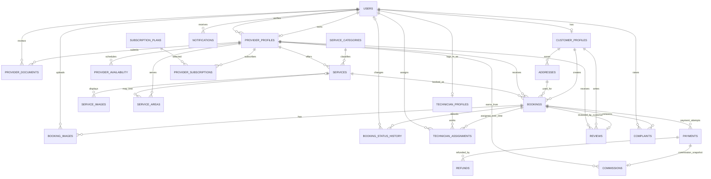

# Database Design Document — Home Services Booking SaaS Platform

**Basis:** `requirements.md`, SRS v1.0 (4 November 2026)  
**Database:** MySQL 8.0.16+ / InnoDB / utf8mb4  
**ORM target:** SQLAlchemy 2.x declarative mappings  
**Scope:** Database design only; no FastAPI, SQLAlchemy model, or backend implementation code.

## 1. Design decisions and SRS traceability

This design implements the SRS logical entities and expands them where normalization or auditability requires it. It covers users and role profiles, provider verification, service catalog, service coverage and availability, customer addresses, bookings, booking evidence/history, technician assignments, payment attempts, refunds, commissions, reviews, complaints, notifications, coupons and provider subscriptions.

- One `users` row represents one account and one primary role, following the SRS MVP assumption.
- `customer_profiles`, `provider_profiles`, and `technician_profiles` are role-specific extension tables. A technician account has exactly one provider in this initial design.
- `services` belongs to one provider and one category. A composite foreign key from booking `(provider_id, service_id)` ensures that the selected service belongs to the selected provider.
- Booking snapshots (`service_name_snapshot`, `service_price_snapshot`, `total_amount`, currency) preserve the agreed commercial terms if the live listing changes.
- A booking is separate from its payments. One booking can have multiple payment attempts. Each attempt has a unique transaction reference and gateway identifiers.
- Refunds are separate rows attached to a payment, allowing partial and multiple refunds. Refund totals must be checked against the captured payment amount in application transactions.
- A commission row is attached to a payment, recording the calculation basis/rate and the resulting provider earning. The example 10% in sample data is illustrative only; the SRS does not approve a real rate.
- Technician assignment is historical: multiple assignment rows can exist over time for reassignment. Composite foreign keys ensure that the assigned technician belongs to the booking's provider.
- Booking status and payment status remain independent.
- Images/documents store Cloudinary or other protected storage references, not binary file contents.
- Timestamps are `DATETIME(6)` and should be written/read in UTC. Appointment timezone/slot policy remains an SRS open decision.

## 2. ER diagram (Mermaid)

## 3. Table inventory

All tables use InnoDB. `BIGINT UNSIGNED AUTO_INCREMENT` is the surrogate primary key unless the table uses a natural one-column primary key. `created_at`/`updated_at` are included where lifecycle tracking is useful. Exact definitions, foreign keys, unique constraints, checks and indexes are in `homeservices_schema.sql`.

| Table | Purpose / primary key | Main relationships | Unique constraints and important indexes |
|---|---|---|---|
| `users` | Shared login/account; PK `id` | Parent of all role profiles; referenced by admin/audit/notification rows | Unique nullable `email`, `phone`; indexes `(role, account_status)`, `full_name` |
| `customer_profiles` | Customer extension; PK/FK `user_id` | 1:1 with `users`; parent of addresses and customer bookings | PK ensures one profile per account |
| `provider_profiles` | Business profile; PK `id` | 1:1 with owner `users`; parent of services, technicians, bookings, documents | Unique `user_id`, business registration no., tax identifier; indexes verification/status and business name |
| `technician_profiles` | Worker profile; PK `id` | 1:1 with technician `users`; belongs to one provider | Unique `user_id`, `(provider_id, employee_code)`, `(provider_id,user_id)` |
| `provider_documents` | Protected verification file references; PK `id` | Many documents per provider; reviewer references `users` | Index `(provider_id,review_status)` |
| `service_categories` | Admin-managed taxonomy; PK `id` | One category to many services | Unique `name`, `slug`; active index |
| `services` | Provider's service listing; PK `id` | Belongs to provider and category; parent of images/areas/bookings | Unique `(provider_id,id)` to support composite FK; indexes category+active, provider+active, name |
| `service_images` | Service image references; PK `id` | Many images per service | Index `(service_id,sort_order)` |
| `service_areas` | Provider/service geographical coverage; PK `id` | Belongs to provider; optional service-specific coverage | Index city/postal/active and provider/service |
| `provider_availability` | Weekly provider working windows; PK `id` | Many availability windows per provider | Unique provider/day/start/end; index provider/day/available |
| `addresses` | Customer-owned service locations; PK `id` | Belongs to customer; referenced by bookings | Unique `(customer_id,id)` for ownership-safe composite FK; customer/default and city/postal indexes |
| `bookings` | Booking aggregate and immutable price/name snapshot; PK `id` | Belongs to customer, provider, service and customer-owned address | Unique reference, `(customer_id,idempotency_key)`, `(provider_id,id)`; indexes for customer/provider status+date and schedule |
| `booking_images` | Problem/before/after evidence; PK `id` | Belongs to booking; uploaded by user | Index booking/stage |
| `booking_status_history` | Append-only booking state audit; PK `id` | Many history rows per booking; actor is a user | Index booking/time and actor/time |
| `technician_assignments` | Current and historical worker allocation; PK `id` | Belongs to booking/provider and technician; assigned by user | Unique `(provider_id,booking_id,id)`; indexes technician/status/date and booking/status |
| `payments` | Individual payment attempts; PK `id` | Belongs to booking and its customer | Unique transaction ref, booking/attempt, gateway/payment ID and gateway/order ID; indexes customer/status/date and booking/status |
| `refunds` | Refund attempts/records; PK `id` | Many refunds per payment; optional admin approver | Unique refund reference and gateway refund ID; index payment/status |
| `commissions` | Financial split snapshot per payment; PK `id` | One commission row per payment; belongs to provider | Unique `payment_id`; index provider/status/date |
| `reviews` | Customer rating/feedback; PK `id` | One review per booking; customer and provider references | Unique `booking_id`; indexes provider/moderation/date and customer/date |
| `complaints` | Booking-related support case; PK `id` | Belongs to booking; raised/assigned/resolved by users | Index status/date, booking, raiser/date |
| `notifications` | In-app notification inbox; PK `id` | Belongs to recipient user | Index user/read/date |
| `coupons` | Promotion definitions; PK `id` | Standalone in this SRS baseline | Unique code; active/date index |
| `subscription_plans` | Provider plan catalog; PK `id` | Parent of provider subscriptions | Unique name/interval; active index |
| `provider_subscriptions` | Provider's subscription history; PK `id` | Belongs to provider and plan | Unique external reference; provider/status/date index |

## 4. Column-level schema reference

The SQL file is the authoritative, executable column definition and includes every column's exact MySQL type, nullability, default, PK, FK, unique constraint, check constraint and index. The following is a compact column guide grouped by table.

| Table | Columns (type) |
|---|---|
| `users` | `id BIGINT UNSIGNED PK`; `role ENUM`; `full_name VARCHAR(150)`; `email VARCHAR(254) NULL`; `phone VARCHAR(20) NULL`; `password_hash VARCHAR(255)`; `account_status ENUM`; `email_verified_at DATETIME(6) NULL`; `phone_verified_at DATETIME(6) NULL`; `last_login_at DATETIME(6) NULL`; `created_at`, `updated_at DATETIME(6)` |
| `customer_profiles` | `user_id BIGINT UNSIGNED PK/FK`; `date_of_birth DATE NULL`; `profile_image_url VARCHAR(1024) NULL`; `preferences_json JSON NULL`; `created_at`, `updated_at DATETIME(6)` |
| `provider_profiles` | `id BIGINT UNSIGNED PK`; `user_id BIGINT UNSIGNED FK UNIQUE`; `business_name VARCHAR(180)`; `legal_business_name VARCHAR(180) NULL`; `business_description TEXT NULL`; `business_registration_no VARCHAR(100) NULL UNIQUE`; `tax_identifier VARCHAR(100) NULL UNIQUE`; `verification_status ENUM`; `verification_rejection_reason TEXT NULL`; `verified_by_admin_id BIGINT UNSIGNED NULL FK`; `verified_at DATETIME(6) NULL`; `is_active BOOLEAN`; `average_rating DECIMAL(3,2)`; `review_count INT UNSIGNED`; `created_at`, `updated_at DATETIME(6)` |
| `technician_profiles` | `id BIGINT UNSIGNED PK`; `user_id BIGINT UNSIGNED FK UNIQUE`; `provider_id BIGINT UNSIGNED FK`; `employee_code VARCHAR(50) NULL`; `skills TEXT NULL`; `is_active BOOLEAN`; `created_at`, `updated_at DATETIME(6)` |
| `provider_documents` | `id BIGINT UNSIGNED PK`; `provider_id BIGINT UNSIGNED FK`; `document_type ENUM`; `file_url VARCHAR(1024)`; `original_file_name VARCHAR(255) NULL`; `mime_type VARCHAR(100) NULL`; `review_status ENUM`; `reviewed_by_admin_id BIGINT UNSIGNED NULL FK`; `reviewed_at DATETIME(6) NULL`; `rejection_reason TEXT NULL`; `created_at DATETIME(6)` |
| `service_categories` | `id BIGINT UNSIGNED PK`; `name VARCHAR(120) UNIQUE`; `slug VARCHAR(140) UNIQUE`; `description TEXT NULL`; `is_active BOOLEAN`; `created_at`, `updated_at DATETIME(6)` |
| `services` | `id BIGINT UNSIGNED PK`; `provider_id BIGINT UNSIGNED FK`; `category_id BIGINT UNSIGNED FK`; `name VARCHAR(180)`; `description TEXT NULL`; `base_price DECIMAL(12,2)`; `estimated_duration_minutes SMALLINT UNSIGNED`; `is_active BOOLEAN`; `created_at`, `updated_at DATETIME(6)` |
| `service_images` | `id BIGINT UNSIGNED PK`; `service_id BIGINT UNSIGNED FK`; `image_url VARCHAR(1024)`; `alt_text VARCHAR(255) NULL`; `sort_order SMALLINT UNSIGNED`; `created_at DATETIME(6)` |
| `service_areas` | `id BIGINT UNSIGNED PK`; `provider_id BIGINT UNSIGNED FK`; `service_id BIGINT UNSIGNED NULL FK`; `country_code CHAR(2)`; `state VARCHAR(100)`; `city VARCHAR(100)`; `postal_code VARCHAR(12) NULL`; `area_name VARCHAR(150) NULL`; `is_active BOOLEAN`; `created_at DATETIME(6)` |
| `provider_availability` | `id BIGINT UNSIGNED PK`; `provider_id BIGINT UNSIGNED FK`; `day_of_week TINYINT UNSIGNED`; `start_time TIME`; `end_time TIME`; `is_available BOOLEAN`; `effective_from DATE NULL`; `effective_until DATE NULL`; `created_at DATETIME(6)` |
| `addresses` | `id BIGINT UNSIGNED PK`; `customer_id BIGINT UNSIGNED FK`; `label VARCHAR(50) NULL`; `recipient_name VARCHAR(150)`; `recipient_phone VARCHAR(20)`; `address_line1 VARCHAR(255)`; `address_line2 VARCHAR(255) NULL`; `landmark VARCHAR(180) NULL`; `city/state VARCHAR(100)`; `postal_code VARCHAR(12)`; `country_code CHAR(2)`; `latitude/longitude DECIMAL(10,7) NULL`; `is_default BOOLEAN`; `created_at`, `updated_at DATETIME(6)` |
| `bookings` | `id BIGINT UNSIGNED PK`; `booking_reference VARCHAR(32) UNIQUE`; `idempotency_key VARCHAR(100)`; `customer_id BIGINT UNSIGNED FK`; `provider_id BIGINT UNSIGNED FK`; `service_id BIGINT UNSIGNED composite FK`; `address_id BIGINT UNSIGNED composite FK`; `scheduled_start_at/scheduled_end_at DATETIME(6)`; `problem_description TEXT NULL`; `status ENUM`; `service_name_snapshot VARCHAR(180)`; `service_price_snapshot/discount_amount/tax_amount/total_amount DECIMAL(12,2)`; `currency CHAR(3)`; `cancellation_reason TEXT NULL`; `cancelled_by_user_id BIGINT UNSIGNED NULL FK`; `completed_at DATETIME(6) NULL`; `created_at`, `updated_at DATETIME(6)` |
| `booking_images` | `id BIGINT UNSIGNED PK`; `booking_id BIGINT UNSIGNED FK`; `uploaded_by_user_id BIGINT UNSIGNED FK`; `image_stage ENUM`; `file_url VARCHAR(1024)`; `caption VARCHAR(255) NULL`; `created_at DATETIME(6)` |
| `booking_status_history` | `id BIGINT UNSIGNED PK`; `booking_id BIGINT UNSIGNED FK`; `old_status ENUM NULL`; `new_status ENUM`; `changed_by_user_id BIGINT UNSIGNED NULL FK`; `change_note TEXT NULL`; `changed_at DATETIME(6)` |
| `technician_assignments` | `id BIGINT UNSIGNED PK`; `booking_id BIGINT UNSIGNED composite FK`; `provider_id BIGINT UNSIGNED composite FK`; `technician_user_id BIGINT UNSIGNED composite FK`; `assigned_by_user_id BIGINT UNSIGNED FK`; `assignment_status ENUM`; `assigned_at/started_at/completed_at/ended_at DATETIME(6)`; `notes TEXT NULL` |
| `payments` | `id BIGINT UNSIGNED PK`; `booking_id/customer_id BIGINT UNSIGNED composite FK`; `attempt_number SMALLINT UNSIGNED`; `gateway VARCHAR(40)`; `gateway_order_id/gateway_payment_id VARCHAR(100) NULL`; `transaction_reference VARCHAR(100) UNIQUE`; `amount DECIMAL(12,2)`; `currency CHAR(3)`; `status ENUM`; `gateway_signature_verified BOOLEAN`; `paid_at DATETIME(6) NULL`; `failure_code VARCHAR(100) NULL`; `failure_message TEXT NULL`; `receipt_url VARCHAR(1024) NULL`; `created_at`, `updated_at DATETIME(6)` |
| `refunds` | `id BIGINT UNSIGNED PK`; `payment_id BIGINT UNSIGNED FK`; `refund_reference VARCHAR(100) UNIQUE`; `gateway_refund_id VARCHAR(100) NULL UNIQUE`; `amount DECIMAL(12,2)`; `status ENUM`; `reason TEXT NULL`; `approved_by_admin_id BIGINT UNSIGNED NULL FK`; `processed_at DATETIME(6) NULL`; `created_at DATETIME(6)` |
| `commissions` | `id BIGINT UNSIGNED PK`; `payment_id BIGINT UNSIGNED FK UNIQUE`; `provider_id BIGINT UNSIGNED FK`; `calculation_type ENUM`; `rate_value DECIMAL(8,4)`; `gross_amount/commission_amount/provider_earning_amount DECIMAL(12,2)`; `currency CHAR(3)`; `status ENUM`; `calculated_at/settled_at DATETIME(6)`; `notes TEXT NULL` |
| `reviews` | `id BIGINT UNSIGNED PK`; `booking_id BIGINT UNSIGNED FK UNIQUE`; `customer_id BIGINT UNSIGNED composite FK`; `provider_id BIGINT UNSIGNED FK`; `rating TINYINT UNSIGNED`; `review_text TEXT NULL`; `moderation_status ENUM`; `moderated_by_admin_id BIGINT UNSIGNED NULL FK`; `moderated_at DATETIME(6) NULL`; `created_at`, `updated_at DATETIME(6)` |
| `complaints` | `id BIGINT UNSIGNED PK`; `booking_id BIGINT UNSIGNED FK`; `raised_by_user_id BIGINT UNSIGNED FK`; `assigned_admin_id BIGINT UNSIGNED NULL FK`; `subject VARCHAR(180)`; `description TEXT`; `status ENUM`; `provider_response TEXT NULL`; `resolution TEXT NULL`; `resolved_by_admin_id BIGINT UNSIGNED NULL FK`; `resolved_at DATETIME(6) NULL`; `created_at`, `updated_at DATETIME(6)` |
| `notifications` | `id BIGINT UNSIGNED PK`; `user_id BIGINT UNSIGNED FK`; `notification_type VARCHAR(60)`; `title VARCHAR(180)`; `message TEXT`; `related_entity_type VARCHAR(40) NULL`; `related_entity_id BIGINT UNSIGNED NULL`; `is_read BOOLEAN`; `read_at DATETIME(6) NULL`; `created_at DATETIME(6)` |
| `coupons` | `id BIGINT UNSIGNED PK`; `code VARCHAR(40) UNIQUE`; `description VARCHAR(255) NULL`; `discount_type ENUM`; `discount_value DECIMAL(10,2)`; `max_discount_amount DECIMAL(12,2) NULL`; `minimum_order_amount DECIMAL(12,2)`; `starts_at/expires_at DATETIME(6) NULL`; `max_redemptions INT UNSIGNED NULL`; `per_customer_limit SMALLINT UNSIGNED NULL`; `is_active BOOLEAN`; `created_at DATETIME(6)` |
| `subscription_plans` | `id BIGINT UNSIGNED PK`; `name VARCHAR(120)`; `description TEXT NULL`; `billing_interval ENUM`; `price DECIMAL(12,2)`; `currency CHAR(3)`; `features_json JSON NULL`; `is_active BOOLEAN`; `created_at`, `updated_at DATETIME(6)` |
| `provider_subscriptions` | `id BIGINT UNSIGNED PK`; `provider_id BIGINT UNSIGNED FK`; `plan_id BIGINT UNSIGNED FK`; `status ENUM`; `starts_at/ends_at DATETIME(6)`; `price_snapshot DECIMAL(12,2)`; `currency CHAR(3)`; `external_subscription_ref VARCHAR(120) NULL UNIQUE`; `cancelled_at DATETIME(6) NULL`; `created_at`, `updated_at DATETIME(6)` |

## 5. Relationships and cardinality

1. **Users and role profiles:** `users` is the authentication root. A customer/provider/technician profile uses the same user ID as its PK and FK, making each extension one-to-one. Role/profile consistency (for example, `role='TECHNICIAN'` for a technician profile) is validated in application logic because a normal FK cannot enforce a value in another table.
2. **Provider and technician:** one provider has many technicians. `technician_profiles.provider_id` identifies the employer. The assignment table uses a composite FK `(provider_id, technician_user_id)` to `(technician_profiles.provider_id, technician_profiles.user_id)`. This prevents assigning a worker employed by a different provider.
3. **Provider and service:** one provider has many services; one category has many services. Booking's composite FK `(provider_id, service_id)` ensures the service belongs to that provider, rather than merely checking that each ID exists independently.
4. **Customer and address:** one customer owns many addresses. Booking's composite FK `(customer_id,address_id)` ensures a booking cannot point to another customer's saved address.
5. **Customer/provider/service and booking:** each booking has exactly one customer, provider, service and address; each of those can be referenced by many bookings. Snapshot columns preserve the accepted service label and price.
6. **Booking and technician assignments:** a booking can have multiple assignment records over time to preserve reassignment history. At most one assignment should be operationally active for a booking at a time; enforce this with a transaction/locking rule or an active-assignment marker strategy in application/database logic. Also validate technician schedule overlap before confirming an assignment.
7. **Booking and payments:** one booking can have multiple payment attempts. Each attempt has its own status. The booking's service status is not coupled to payment status. A unique `(booking_id,attempt_number)` prevents duplicate attempt numbering; unique gateway IDs and transaction reference support idempotent webhook processing.
8. **Payment and refunds:** one payment can have multiple refunds, supporting partial refunds. Application logic must ensure cumulative successful refunds do not exceed the payment's captured amount.
9. **Payment and commission:** one payment can have at most one commission snapshot. Store the applied rule and monetary breakdown so later rule changes do not rewrite history. Settlement is not an automatic payout.
10. **Booking and review:** unique `reviews.booking_id` allows at most one review per booking. Only allow insert when booking is completed and customer matches booking owner.
11. **Booking and status history:** every status transition appends a row with old/new status, actor and timestamp. The first row has `old_status = NULL`.
12. **Notifications, complaints and subscriptions:** notifications belong to recipients; complaints reference a booking and relevant users; provider subscription rows preserve plan and price history.

## 6. SQL CREATE TABLE scripts and sample data

Download and run **`homeservices_schema.sql`** in MySQL 8.0.16 or newer. It includes:
- `CREATE DATABASE`, all 23 tables, columns and constraints;
- primary/foreign keys, unique constraints, check constraints and indexes;
- sample connected customer/provider/technician/service/booking/payment/commission/review/notification records.

Sample password hashes are placeholders and cannot be used to log in. Replace them with real Argon2id/bcrypt hashes generated by the application. Sample IDs are fixed for clarity; remove or adapt sample inserts for production seeding.

## 7. Booking, provider, technician and payment integrity — critical rules

### Booking integrity
- Booking must use a service belonging to its selected provider; enforced by composite FK.
- Booking address must belong to the booking customer; enforced by composite FK.
- Unique booking reference and `(customer_id,idempotency_key)` protect against duplicate submissions.
- Schedule overlap prevention is not fully expressible with a simple MySQL FK/unique key because intervals can overlap. In one transaction, lock the provider/technician schedule rows (or a dedicated slot row), query conflicting non-cancelled bookings, then insert/confirm. Use a consistent lock order to avoid deadlocks.
- Rejected/cancelled bookings should release the slot according to policy. Status transitions must follow the SRS transition matrix.

### Provider and technician integrity
- Provider must be approved and active before publishing services.
- Technician account must be active and belong to the booking's provider.
- Composite assignment FKs prevent cross-provider assignment.
- Before assignment, check that technician has no overlapping active job. Preserve old assignment rows as `REASSIGNED`/`CANCELLED`; do not overwrite assignment history.
- Access control must still be enforced by API authorization; FKs do not replace row-level permission checks.

### Payment integrity
- Keep payment state separate from booking state.
- Only verified gateway callbacks/webhooks can set a payment to `PAID`.
- Use gateway order/payment identifiers and transaction reference as unique idempotency keys.
- Record every attempt, including pending and failed attempts.
- Create commission only after the business-defined qualifying payment event; snapshot calculation type, rate, gross, commission and provider earning.
- Refunds are separate records; check cumulative successful refunds against captured amount.
- A payment record/commission record is not evidence that provider payout has occurred. Payout/settlement automation is out of scope in the SRS MVP.

## 8. Indexing strategy

Indexes are designed around expected access patterns:
- Login and account administration: unique email/phone, `(role,account_status)`, `full_name`.
- Marketplace: category/active, provider/active, service name, city/postal service area.
- Customer dashboard: `(customer_id,status,scheduled_start_at)`.
- Provider dashboard: `(provider_id,status,scheduled_start_at)`.
- Schedule conflict checks: `(scheduled_start_at,scheduled_end_at)` plus provider/status index.
- Technician job list: `(technician_user_id,assignment_status,assigned_at)`.
- Payment history: `(customer_id,status,created_at)` and `(booking_id,status)`.
- Provider earnings: `(provider_id,status,calculated_at)`.
- Notification inbox: `(user_id,is_read,created_at)`.
- Complaint queue: `(status,created_at)`.

Avoid adding indexes to every column: indexes add write cost and should be reviewed using real query plans and production-like data.

## 9. SQLAlchemy compatibility notes

- Use `BigInteger` with MySQL unsigned variants or a consistent signed `BigInteger` convention in SQLAlchemy. Ensure FK and PK signedness match exactly.
- Map `DECIMAL` to `Numeric(12,2)` / `Numeric(8,4)`, not Python float.
- Map MySQL `ENUM` explicitly or use constrained strings; keep application enum values identical to database values.
- Map JSON to SQLAlchemy `JSON`.
- Use `DateTime(fsp=6)` / `Time` and normalize timestamps to UTC in application code.
- Declare composite constraints using `ForeignKeyConstraint`, and unique/index definitions with `UniqueConstraint` and `Index`.
- Use explicit `relationship()` pairs for object navigation; ORM cascades should match database `ON DELETE` behavior.
- The SQL script is the physical source of truth; migrations should be generated/reviewed against it rather than assuming ORM `create_all()` is a migration system.

## 10. SRS open decisions that affect schema/application rules

The SRS explicitly leaves these undecided; this design does not pretend they are approved:
1. Whether payment is collected at booking time or after service completion.
2. Whether customers can pay after completion and how failed/pending payments affect job completion.
3. Cancellation policy and refund policy, including post-assignment cancellation.
4. Commission basis/rate and when commission is earned.
5. Manual provider settlement procedure and whether payout tracking will be added.
6. Provider response expiry and slot release policy.
7. Fixed-price versus inspection/extra-charge services.
8. Appointment timezone and slot duration policy.
9. Coupon redemption tracking and subscription billing details. The current schema includes coupon definitions and subscription plans/history, but not coupon redemption ledger or subscription invoice/payment ledger; add these after rules are approved.
10. Whether technician accounts may later work for multiple providers. Current schema follows the SRS MVP assumption: one provider per technician.

## 11. Recommended validation before production

- Run the SQL against the exact MySQL minor version selected for deployment.
- Test all foreign keys, uniqueness and check constraints.
- Add integration tests for cross-provider technician assignment and cross-customer address selection (both should fail).
- Test duplicate booking idempotency and duplicate gateway webhook delivery.
- Test overlapping provider/technician appointments under concurrent requests.
- Test partial and cumulative refunds.
- Reconcile commission calculations against finance-approved examples.
- Confirm retention, deletion/anonymization and access policies for identity documents and customer addresses.
